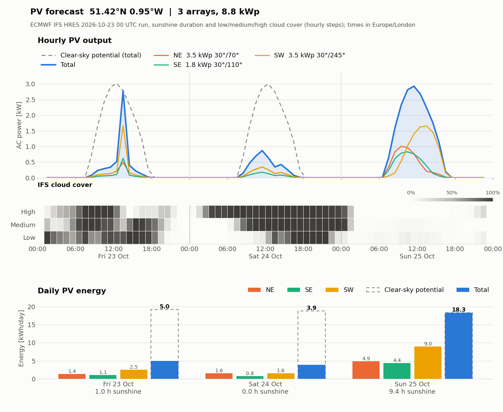

# PV generation forecast from ECMWF IFS

A 3-day forecast of AC output for a home PV system, built from the ECMWF IFS HRES
**sunshine duration** and **low / medium / high cloud cover** forecasts. It produces a
plot, an hourly CSV table and a console summary, and can publish the plot to GitHub so
it can be shown in phone widgets.



*Example output (IFS run 2026-10-23 00 UTC): hourly power per array and in total, the
IFS cloud-cover layers, and daily energy compared with the clear-sky potential.*

## Contents

| File | Purpose |
|---|---|
| `pv_forecast_ifs.py` | The forecast: downloads IFS data, models the PV output, writes the plot and CSV |
| `pv_forecast.sh` | Wrapper that runs the forecast with the site's array settings and publishes the plot |
| `pv_forecast.png` | Latest plot (output) |
| `pv_forecast_hourly.csv` | Latest hourly table (output) |
| `pv_forecast.log` | Log of the last scheduled run (ECMWF API / MARS messages) |

## How it works

### Data

IFS HRES surface fields are fetched from MARS through the ECMWF Web API for a small
box (±0.2°, 0.1° grid) around the site, and cached as NetCDF in `ifs_cache/`:

| Parameter | Field | Used for |
|---|---|---|
| 189 `sund` | Sunshine duration (accumulated) | Sunshine fraction |
| 167 `2t` | 2 m temperature | Cell temperature |
| 186 / 187 / 188 `lcc` `mcc` `hcc` | Low / medium / high cloud cover | Cloud transmission |
| 164 `tcc` | Total cloud cover | Overlap of the cloud layers |

Steps are hourly up to +90 h and 3-hourly after that, so a 3-day forecast is fully
hourly. The most recent 00 or 12 UTC run is used (they appear in MARS about 7 h after
base time); if it is not there yet, the script falls back to the previous run.

### Model

For each forecast interval, evaluated every 5 minutes:

1. **Clear sky.** Sun position (NOAA approximations) and Ineichen-Perez clear-sky GHI,
   DNI and DHI.
2. **Sunshine fraction `f`.** IFS sunshine seconds divided by the seconds in which the
   sun could shine, i.e. where clear-sky DNI > 120 W/m² (the WMO threshold).
3. **All-sky irradiance.**
   - beam = `f` · DNI<sub>cs</sub>
   - diffuse = `f` · DHI<sub>cs</sub> + (1 − `f`) · `T_cloud` · GHI<sub>cs</sub>
4. **Cloud transmission `T_cloud`.** Each layer lets through a fixed share of the
   clear-sky GHI (low 25 %, medium 45 %, high 75 %). The layers are combined with an
   overlap that blends random and maximum overlap so that the clear fraction matches
   `1 − tcc`. Stacked layers mean more clear sky and thicker cloud, hence a lower
   `T_cloud`. With almost no cloud, the cover-weighted mean of the layer
   transmissions is used; with none at all, `--k-overcast` (0.3).
5. **Per array.** Plane-of-array irradiance (isotropic sky, ground albedo, ASHRAE
   incidence-angle losses), NOCT cell temperature, PVWatts-style DC power, system
   losses and inverter efficiency.
6. **Shared inverter.** Arrays are summed and, if `--inverter-kw` is given, the total
   is clipped. All arrays are scaled down by the same factor.

### Reading the plot

- **Hourly PV output**: total (blue), each array, and the clear-sky potential (dashed).
- **IFS cloud cover**: low / medium / high layers, darker means more cloud.
- **Daily PV energy**: kWh per array and in total, with the clear-sky potential
  outlined. The label under each day is the IFS sunshine duration.

## Requirements

- Python 3 with `numpy`, `pandas`, `xarray`, `scipy` (NetCDF reader), `matplotlib`
- `ecmwf-api-client` (`ecmwfapi`)
- An ECMWF account with MARS access, with credentials in `~/.ecmwfapirc`

```bash
pip install numpy pandas xarray scipy matplotlib ecmwf-api-client
```

## Usage

Defaults (site, `ARRAYS`) are set at the top of `pv_forecast_ifs.py`.

```bash
# Single array
python3 pv_forecast_ifs.py --lat 51.42 --lon -0.95 --tz Europe/London \
    --capacity 4.2 --tilt 35 --azimuth 180

# Several arrays, one value per array
python3 pv_forecast_ifs.py --arrays 3 --capacity 3.5 1.8 3.5 --tilt 30 30 30 \
    --azimuth 65 110 245 --name NE SE SW --inverter-kw 9

# Same thing, one option per array: kWp,tilt,azimuth[,name]
python3 pv_forecast_ifs.py --array 3.5,30,65,NE --array 1.8,30,110,SE --array 3.5,30,245,SW
```

Azimuth is measured clockwise from north (90 = E, 180 = S, 270 = W). Up to 7 arrays
are supported.

### Options

| Option | Default | Meaning |
|---|---|---|
| `--lat`, `--lon`, `--elevation` | 51.42, −0.95, 73 m | Site |
| `--tz` | `Europe/London` | Time zone for days and plot |
| `--arrays`, `--capacity`, `--tilt`, `--azimuth`, `--name` | | Array definition (1 value for all, or one per array) |
| `--array KWP,TILT,AZ[,NAME]` | | One array per option, repeatable |
| `--inverter-kw` | none | Shared inverter AC limit |
| `--days` | 3 | Forecast days (1–5; hourly data covers 3) |
| `--run "YYYY-MM-DD HH"` | latest | Use a specific IFS run (UTC) |
| `--losses` | 0.10 | DC system losses |
| `--inverter-eff` | 0.96 | Inverter efficiency |
| `--gamma` | −0.0037 /K | Power temperature coefficient |
| `--noct` | 45 °C | Nominal operating cell temperature |
| `--albedo` | 0.2 | Ground reflectance |
| `--linke` | 3.0 | Linke turbidity (2 clean to 5 hazy) |
| `--k-overcast` | 0.3 | Overcast GHI fraction when no layer has cloud |
| `--no-tcc` | off | Ignore `tcc`, assume random layer overlap |
| `--out`, `--csv` | `pv_forecast.png`, `pv_forecast_hourly.csv` | Output files |
| `--show` | off | Also open the plot window |

## Outputs

**Console:** the array list, a daily table (energy, clear-sky energy, peak power,
per-array energy, mean cloud cover, sunshine hours) and the total.

**`pv_forecast_hourly.csv`**, one row per hour in the local time zone:

| Column | Meaning |
|---|---|
| `time (Europe/London)` | Start of the hour |
| `pv_kw` | Total AC power (hourly mean) |
| `NE_kw`, `SE_kw`, `SW_kw` | Per-array AC power (named after `--name`) |
| `clearsky_kw` | Total AC power under clear sky |
| `ghi_wm2` | All-sky global horizontal irradiance |
| `t2m_c` | 2 m air temperature |
| `lcc_pct`, `mcc_pct`, `hcc_pct` | Low / medium / high cloud cover |
| `cloud_trans` | Effective cloud transmission `T_cloud` |
| `sunshine_min` | IFS sunshine minutes in the hour |

## Scheduled run and publishing

`pv_forecast.sh` runs the forecast for the 3-array system (NE 3.5 kWp / SE 1.8 kWp /
SW 3.5 kWp, all tilted 30°, 9 kW inverter) and then publishes the plot through the
same GitHub repository as the satellite images:

1. Copy `pv_forecast.png` into the satellite image folder under a temporary name and
   rename it, so the publisher never sees a half-copied file (`cp -p` keeps the
   plot's modification time).
2. Wait 16 s (`publish_sat.sh` only picks up files unchanged for 15 s), then run
   `publish_sat.sh`, which commits the images and pushes them to the `sat-images`
   repository (`main`).
3. If `publish_sat.sh` is missing, the plot is left in the folder for the next
   scheduled run to publish.

Edit `PY`, `WORKDIR`, `SAT_DIR` and `PUBLISH_SCRIPT` at the top of the script for your
machine.

### Schedule

Run it twice a day, shortly after each IFS run reaches MARS (about 7 h after 00 and
12 UTC):

```cron
0 8,20 * * * /path/to/pv_forecast.sh >> /path/to/pv_forecast.log 2>&1
```

At 08:00 this picks up the 00 UTC run and at 20:00 the 12 UTC run, as in
`pv_forecast.log`. The 20:00 run takes a few minutes in the ECMWF queue.

On macOS, cron needs Full Disk Access, and the script uses absolute paths because cron
has a minimal environment.

## Notes and limitations

- The model has no per-site calibration. The cloud transmissions (0.25 / 0.45 / 0.75),
  `--losses` and `--linke` are reasonable defaults, and fitting them against measured
  generation would improve it.
- Sunshine duration comes from a 0.1° grid point nearest to the site, so very local
  effects (shading, hills) are not captured.
- Only the nearest grid point is used, with no interpolation between cells.
- Values are hourly means of 5-minute power; hours with scattered cloud can show sharp
  spikes (as in the 23 Oct example), reflecting how IFS distributes sunshine within the
  hour.
